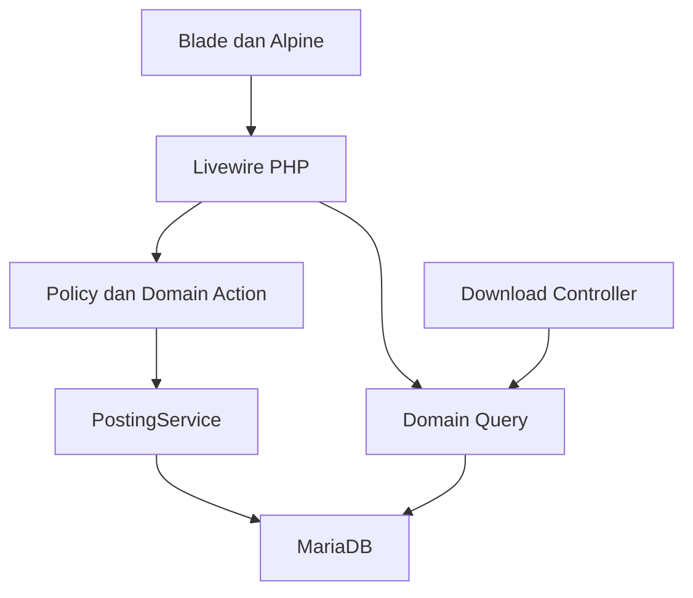

# 02 — Arsitektur full Laravel modular

## Stack tunggal

PHP8.2.12, Laravel12.x, Blade, Livewire3.x, Tailwind4, Alpine bawaan Livewire, MariaDB10.4.32 (XAMPP, port3306). Composer2.6.6 digunakan dari komputer pengguna. PHPUnit11 menjadi runner test. Frontend dan backend hidup dalam satu repository Laravel dan satu deployment. Vite/Node hanya membangun CSS dan JavaScript pendukung.

Blade menghasilkan HTML di server. Livewire mengelola state form, filter dan tabel dengan class PHP dan view Blade. Alpine dipakai untuk interaksi lokal seperti dropdown/sidebar. Perhitungan uang tetap pada domain backend. Tidak ada aplikasi frontend terpisah, REST untuk setiap form, atau npm framework UI sebagai lapisan bisnis.

## Pembagian tanggung jawab

| Lapisan | Tanggung jawab | Tidak dikerjakan di sini |
|---|---|---|
| Blade component | Layout, field, tabel, dialog, status | Query langsung atau rumus keuangan |
| Livewire component / Form | State input, validasi, authorize, panggil Action/Query | Posting jurnal langsung |
| HTTP Controller | Login melalui Fortify, download/export dan endpoint HTTP khusus | Duplikasi domain action |
| Domain Action | Satu use case bisnis | Markup UI |
| Domain Query | Dataset dashboard/laporan/subledger | Mengubah transaksi |
| Eloquent Model | Relasi, casts, scopes | Observer yang membentuk jurnal tersembunyi |
| Policy | Hak akses pengguna pada record/action | Hanya menyembunyikan menu |
| PostingService | Efek keuangan atomik | Operasi queue terpisah untuk jurnal |

FormRequest dipakai pada endpoint Controller. Livewire memakai Form object/rules sendiri melalui shared validation rules agar tidak memaksakan FormRequest HTTP ke lifecycle Livewire. Invariant finansial selalu diverifikasi ulang pada Action.



## Struktur folder

```text
app/
  Models/                         #18 model inti+4 pendukung
  Livewire/
    Dashboard/Index.php
    MasterData/{Units,Accounts,Parties,Products}/
    OpeningBalance/
    Trading/{Sales,Purchases}/
    Cash/{Receipts,Payments}/
    Lending/{Loans,Installments}/
    Inventory/{Stock,StockCards,Stocktakes}/
    FixedAssets/
    Accounting/{Journals,GeneralLedger,Periods}/
    Reporting/
    VillageReport/
    Evidence/
    Audit/
    Forms/                        # Form objects per domain
  Domain/
    Identity/
    MasterData/
    OpeningBalance/
    Trading/
    Cash/
    Lending/
    Inventory/
    FixedAssets/
    Accounting/
    Periods/
    Reporting/
    VillageReport/
    Evidence/
    Audit/
    Shared/                       # Decimal, clock, exceptions, rules
  Http/
    Controllers/{Exports,Evidence}/
    Requests/                     # hanya endpoint HTTP biasa
    Middleware/EnsureUserActive.php
  Policies/
  Providers/FortifyServiceProvider.php
  Jobs/                           # export besar pasca commit
  Console/Commands/
resources/
  views/
    components/
      layouts/{app,guest}.blade.php
      ui/                         # button,input,card,badge,modal,table
      shared/                     # period-filter,journal-preview,evidence-list
    livewire/                     # mirror kelompok app/Livewire
    auth/login.blade.php
    reports/                      # template PDF
  css/app.css
  js/app.js                       # charts/local helpers; tanpa Alpine.start()
routes/web.php
routes/modules/{module}.php
config/accounting.php
config/livewire.php                # jika customization perlu
storage/app/private/
database/{migrations,seeders,factories}/
tests/Unit/{Module}/
tests/Feature/{Module}/
tests/Feature/Livewire/
tests/Browser/
docs/
.github/copilot-instructions.md
PROGRESS.md
```

Dalam domain gunakan Actions/Queries/Data/Enums/Services ketika perlu. Komponen Livewire yang mulai mencampur banyak proses dipecah menjadi form, index, detail dan komponen presentasi. Hindari abstract CRUD framework yang menyembunyikan aturan tiap transaksi.

## Kepemilikan data

| Modul | Menulis | Bergantung pada |
|---|---|---|
| MasterData | Metadata unit/akun/pihak/produk | Identity |
| OpeningBalance | Opening+rincian+lock | Rekonsiliasi, Inventory |
| Trading/Cash/Lending/FixedAssets | Draft dan sumber domain | PostingService |
| Accounting | Jurnal dan status transaksi | PeriodGuard, posting strategy |
| Inventory | Mutasi stok, cache stok, opname | Transaksi DB posting yang sama |
| Reporting | Tidak menulis ledger | LedgerQuery dan subledger queries |
| VillageReport | Snapshot dan workflow | ReportService dan Evidence |
| Audit | Log append-only | Use case terotorisasi |

Sumber kebenaran: opening terkunci+jurnal efektif untuk ledger; mutasi_stok untuk stok; alokasi pembayaran untuk pinjaman/piutang/utang; snapshot untuk laporan desa resmi. Cache tidak boleh menjadi sumber laporan historis.

## Lifecycle UI dan keamanan

GET route menuju full-page Livewire component dengan auth+status middleware. Setiap public mutation method Livewire melakukan authorize ulang, validasi, load record server, lalu Action. Jangan menganggap mount() atau property #[Locked] sudah menggantikan Policy. User dapat memanggil public method tanpa tombol terlihat.

Route update Livewire membawa middleware persisten yang diperlukan; daftarkan EnsureUserActive sebagai persistent middleware dan uji user dinonaktifkan setelah halaman terbuka. Action tetap memeriksa actor aktif untuk perlindungan finansial.

Public properties hanya ID/state input yang aman. Jangan mengirim path private, password hash, secret atau model penuh berisi atribut sensitif ke browser. Gunakan #[Locked] untuk source ID yang tetap, tetapi validasi hak atas record tetap wajib.

## Lingkungan dan validasi

Development Windows (XAMPP MariaDB10.4.32); staging/production PHP-FPM+MariaDB dengan asset Vite terbuild. CI memakai MariaDB sungguhan untuk lock/constraint. Tes Livewire dengan Livewire::test untuk form/actions, PHPUnit untuk domain, browser untuk interaksi Alpine dan navigasi. composer.lock/package-lock.json dikunci setelah resolver berhasil terhadap PHP8.2.12.
