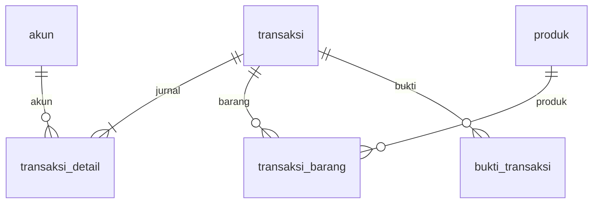
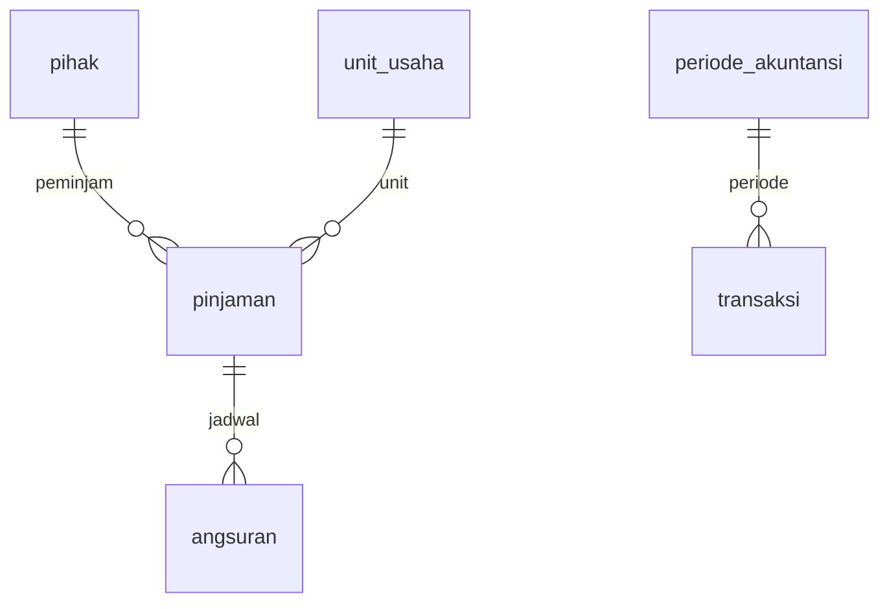
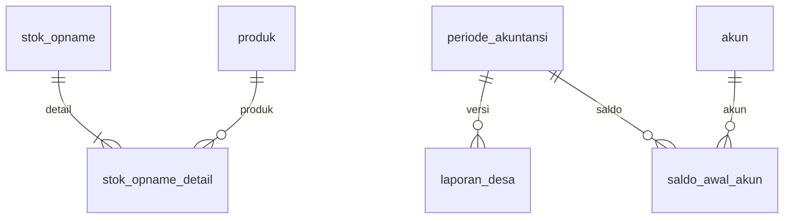

# 04 — Database inti sesuai laporan

Sumber: PDF h.70–88, khusus kamus tabel h.77–88. **18 tabel bisnis inti** di bawah dipertahankan. Dokumen ini mencatat baseline PDF; implementasi lengkap menggabungkannya dengan dokumen 05. Tabel framework seperti sessions, jobs, cache, migrations bukan tabel domain penelitian.

> **Engine:** target proyek adalah MariaDB 10.4.32 (InnoDB, utf8mb4/`utf8mb4_unicode_ci`, koneksi driver `mariadb`). CHECK ditegakkan sejak MariaDB 10.2.1; generated column untuk unique key harus STORED; kolom `json` disimpan sebagai LONGTEXT+`json_valid`. Detail di dokumen03 §MariaDB 10.4.

## Konvensi

`id` = BIGINT UNSIGNED PK auto increment. FK menggunakan tipe yang sama. `?` berarti nullable; tanpa `?` wajib. D = DECIMAL(15,2); S(n) = VARCHAR(n); B = BIGINT UNSIGNED; TS = DATETIME. Default angka debit/kredit/cache = 0. FK default RESTRICT saat delete untuk data keuangan; pengguna dinonaktifkan, tidak dihapus. Tipe status diimplementasikan VARCHAR + PHP backed enum + validasi server. Unique ditulis UQ.

Nominal tidak memakai float/double. Detail precision implementasi ada pada dokumen 05. Tidak menambahkan cascade delete ke ledger. Timestamp tambahan audit di tabel yang belum memilikinya merupakan perluasan teknis.

## 1. users — PDF h.77

| Field | Tipe / aturan |
|---|---|
| id | B PK |
| nama | S(100) |
| email | S(100) UQ; normalisasi lowercase |
| password | S(255); password hash |
| role | S(20): admin, pimpinan |
| status | S(20): aktif, nonaktif |
| created_at, updated_at | TS |

Tidak membuat tabel roles. Nama properti frontend `auth.user.nama` harus konsisten.

## 2. unit_usaha — h.77

| Field | Tipe / aturan |
|---|---|
| id | B PK |
| kode_unit | S(20) UQ |
| nama_unit | S(100) |
| jenis_usaha | S(20): dagang, kredit |
| penanggung_jawab | S(100) |
| status | S(20): aktif, nonaktif |

Narasi h.71 juga menyebut jasa; baseline seed dagang dan kredit, jenis jasa dicatat sebagai kemungkinan perluasan, bukan seed unit nyata tanpa data.

## 3. periode_akuntansi — h.78

| Field | Tipe / aturan |
|---|---|
| id | B PK |
| bulan, tahun | integer; bulan 1–12 |
| tanggal_mulai, tanggal_selesai | DATE |
| status | S(20): terbuka, ditutup |
| closed_by | B? FK users |
| closed_at | TS? |

UQ(tahun,bulan); rentang tanggal tepat satu bulan kalender, tidak overlap. Periode terpilih di UI bukan alasan untuk mengubah semua transaksi ke periode itu; tanggal transaksi menentukan periode.

## 4. akun — h.78

| Field | Tipe / aturan |
|---|---|
| id | B PK |
| kode_akun | S(20) UQ |
| nama_akun | S(100) |
| jenis_akun | S(30): aset, kewajiban, modal, pendapatan, hpp, beban |
| saldo_normal | S(10): debit, kredit |
| is_active | BOOLEAN |

Akun kontra seperti akumulasi penyusutan berjenis aset, saldo normal kredit. Jangan memaksakan semua aset bersaldo debit. Akun yang sudah digunakan tidak boleh berganti jenis/saldo normal tanpa migrasi terkontrol.

## 5. saldo_awal_akun — h.79

| Field | Tipe / aturan |
|---|---|
| id | B PK |
| periode_id | B FK periode_akuntansi |
| unit_usaha_id | B? FK unit_usaha |
| akun_id | B FK akun |
| saldo_debit, saldo_kredit | D >=0 |
| keterangan | TEXT? |
| created_by | B FK users |

Satu sisi positif, sisi lain nol; boleh keduanya nol jika form kosong dinormalisasi tidak tersimpan. Unik per periode+scope unit+akun. MariaDB (seperti MySQL) membolehkan beberapa NULL dalam unique; gunakan generated **STORED** `scope_unit_id=COALESCE(unit_usaha_id,0)` (bukan VIRTUAL, agar unique index andal di MariaDB 10.4) dan UQ(periode_id,scope_unit_id,akun_id). Nilai 0 hanya generated key, bukan FK unit fiktif.

## 6. pihak — h.79

| Field | Tipe / aturan |
|---|---|
| id | B PK |
| kode_pihak | S(20) UQ |
| jenis_pihak | S(20): pelanggan, pemasok, peminjam |
| nama | S(100) |
| nomor_identitas | S(30)? |
| alamat | TEXT? |
| telepon | S(20)? |
| status | S(20): aktif, nonaktif |

Satu record satu jenis sesuai PDF. Satu orang yang berperan lebih dari satu menggunakan kode pihak berbeda sampai ada kebutuhan multi-role resmi. Jangan menganggap NIK selalu tersedia atau memakainya sebagai PK.

## 7. produk — h.80

| Field | Tipe / aturan |
|---|---|
| id | B PK |
| unit_usaha_id | B FK unit_usaha |
| kode_produk | S(20) UQ |
| nama_produk | S(100) |
| satuan | S(20) |
| harga_beli, harga_jual | D >=0 |
| stok_terkini, stok_minimum | D >=0 |
| status | S(20): aktif, nonaktif |

stok_terkini hanya cache service. Harga_beli master bukan otomatis harga pokok historis. Unit produk tidak dapat diganti setelah ada mutasi.

## 8. transaksi — h.80–81

| Field | Tipe / aturan |
|---|---|
| id | B PK |
| nomor_transaksi | S(30) UQ |
| tanggal | DATE |
| periode_id | B FK periode_akuntansi |
| unit_usaha_id | B? FK unit_usaha |
| pihak_id | B? FK pihak |
| user_id | B FK users; pembuat |
| jenis_transaksi | S(30): pembelian, penjualan, pemasukan, pengeluaran, pencairan, angsuran, penyusutan, penyesuaian |
| sumber_tipe | S(30)? |
| sumber_id | B? |
| total | D >=0 |
| keterangan | TEXT? |
| status | S(20): draft, posted, reversed |
| reversal_of_id | B? FK transaksi; UQ untuk satu pembalik per sumber |
| posted_by | B? FK users |
| posted_at | TS? |
| created_at, updated_at | TS |

sumber_tipe/sumber_id adalah referensi polimorfik dengan allowlist, bukan FK lintas tabel sungguhan. Service memverifikasi keduanya secara eksplisit. Pembalik menggunakan jenis yang sama, dengan reversal_of_id terisi; tidak perlu jenis transaksi kesembilan.

## 9. transaksi_detail — h.82

| Field | Tipe / aturan |
|---|---|
| id | B PK |
| transaksi_id | B FK transaksi |
| akun_id | B FK akun |
| debit, kredit | D default 0 |
| keterangan | TEXT? |

CHECK((debit>0 AND kredit=0) OR (kredit>0 AND debit=0)). Keseimbangan antarbanyak baris tidak dapat dijamin CHECK row; PostingService wajib memvalidasi SUM debit=kredit dalam DB transaction. Minimum dua baris bernilai positif. Ini jurnal resmi, bukan transaksi_barang.

## 10. transaksi_barang — h.82

| Field | Tipe / aturan |
|---|---|
| id | B PK |
| transaksi_id | B FK transaksi |
| produk_id | B FK produk |
| kuantitas | D >0 |
| harga | D >=0 |
| harga_pokok | D >=0; snapshot |
| subtotal | D >=0 |

Harga saat penjualan = harga jual; harga_pokok snapshot ditentukan server saat posting. Perluasan presisi dan diskon/pajak di dokumen 05. Banyak baris produk yang sama diperbolehkan jika ada alasan harga berbeda, tetapi locking produk dilakukan unik.

## 11. pinjaman — h.82–83

| Field | Tipe / aturan |
|---|---|
| id | B PK |
| nomor_pinjaman | S(30) UQ |
| unit_usaha_id | B FK unit_usaha jenis kredit |
| peminjam_id | B FK pihak jenis peminjam |
| tanggal_pinjaman | DATE |
| pokok_pinjaman | D >0 |
| persentase_bunga | DECIMAL(8,2) >=0 |
| tenor | integer >0, bulan |
| total_bunga, sisa_pokok | D >=0 |
| status | S(20): draft, aktif, lunas, macet, dibatalkan |
| transaksi_id | B? FK transaksi pencairan; UQ |

Status macet tidak disimpulkan hanya dari satu hari terlambat; butuh penetapan terotorisasi dan alasan. Blueprint awal hanya menurunkan indikator terlambat dari jadwal, tanpa perubahan status macet otomatis.

## 12. angsuran — h.83–84

| Field | Tipe / aturan |
|---|---|
| id | B PK |
| pinjaman_id | B FK pinjaman |
| angsuran_ke | integer >0 |
| tanggal_jatuh_tempo | DATE |
| pokok_tagihan, bunga_tagihan | D >=0 |
| pokok_dibayar, bunga_dibayar | D >=0; cache |
| tanggal_bayar | DATE? |
| status | S(20): belum_dibayar, sebagian, lunas, terlambat |
| transaksi_id | B? FK transaksi |

UQ(pinjaman_id,angsuran_ke). Satu transaksi_id tidak memadai untuk banyak pembayaran parsial: tetap pertahankan field baseline sebagai pointer kompatibilitas ke pembayaran terakhir; sumber historis ada pada pembayaran_angsuran (dokumen 05).

## 13. aset_tetap — h.84

| Field | Tipe / aturan |
|---|---|
| id | B PK |
| kode_aset | S(20) UQ |
| unit_usaha_id | B? FK unit_usaha |
| nama_aset | S(100) |
| tanggal_perolehan | DATE |
| harga_perolehan, nilai_residu | D >=0; residu <= perolehan |
| umur_manfaat | integer >0; bulan |
| metode_penyusutan | S(20): garis_lurus |
| status | S(20): aktif, dilepas, dihapus |

Status bukan perintah menghapus record. Pelepasan membutuhkan alur finansial tersendiri jika kelak dimasukkan scope.

## 14. bukti_transaksi — h.85

| Field | Tipe / aturan |
|---|---|
| id | B PK |
| transaksi_id | B FK transaksi |
| nomor_bukti | S(30) |
| tanggal_bukti | DATE |
| jenis_bukti | S(20): nota, kuitansi, transfer, kas_masuk, kas_keluar |
| file_bukti | S(255); path privat |
| status_verifikasi | S(20): belum_diperiksa, valid, ditolak |
| uploaded_by | B FK users |
| verified_by | B? FK users |

Nomor bukti eksternal belum tentu unik lintas pemasok. Download harus melalui policy; path tidak diterima mentah dari frontend.

## 15. laporan_desa — h.85–86

| Field | Tipe / aturan |
|---|---|
| id | B PK |
| nomor_laporan | S(30) UQ |
| periode_id | B FK periode_akuntansi |
| omzet_dagang, pendapatan_kredit, pendapatan_lain, total_omzet | D |
| snapshot_data | JSON |
| status | S(20): draft, diajukan, disetujui, dikirim, diterima, revisi |
| catatan_pimpinan | TEXT? |
| approved_by | B? FK users |
| approved_at | TS? |
| file_laporan | S(255)? privat |
| tanggal_dikirim, tanggal_diterima | DATE? |
| bukti_penerimaan | S(255)? privat |

Satu periode dapat memiliki beberapa versi, sehingga tidak memasang unique periode_id saja. Nilai neto laporan dapat negatif akibat koreksi; jangan CHECK nominal laporan >=0 secara membabi buta.

## 16. log_aktivitas — h.86

| Field | Tipe / aturan |
|---|---|
| id | B PK |
| user_id | B FK users |
| modul | S(50) |
| aksi | S(30) |
| referensi_tipe | S(30) |
| referensi_id | B |
| nilai_lama, nilai_baru | JSON? |
| alasan | TEXT? |
| created_at | TS |

Append-only. Tidak menyimpan password, token, isi dokumen sensitif ke JSON. Actor pekerjaan async diturunkan dari peminta, bukan role superuser fiktif.

## 17. stok_opname — h.87

| Field | Tipe / aturan |
|---|---|
| id | B PK |
| nomor_opname | S(30) UQ |
| tanggal | DATE |
| periode_id | B FK periode_akuntansi |
| unit_usaha_id | B FK unit_usaha |
| status | S(30): draft, selesai, menunggu_persetujuan, disetujui, posted, dibatalkan |
| nilai_selisih | D; boleh negatif |
| created_by | B FK users |
| approved_by, posted_by | B? FK users |
| created_at | TS |
| posted_at | TS? |

Permintaan revisi mengembalikan status ke draft + alasan dalam audit; tidak perlu status inti baru.

## 18. stok_opname_detail — h.88

| Field | Tipe / aturan |
|---|---|
| id | B PK |
| stok_opname_id | B FK stok_opname |
| produk_id | B FK produk |
| stok_sistem, stok_fisik | D >=0 |
| selisih | D; fisik-sistem |
| harga_pokok | D >=0 |
| nilai_selisih | D; boleh negatif |
| keterangan | TEXT? |
| transaksi_id | B? FK transaksi |

UQ(stok_opname_id,produk_id). Satu transaksi penyesuaian boleh dirujuk beberapa detail opname.

## Indeks minimum

- transaksi(periode_id,unit_usaha_id,tanggal,id), (pihak_id,tanggal), (status,tanggal), (sumber_tipe,sumber_id).
- transaksi_detail(akun_id,transaksi_id), transaksi_barang(produk_id,transaksi_id).
- pinjaman(peminjam_id,status), angsuran(tanggal_jatuh_tempo,pinjaman_id).
- bukti_transaksi(transaksi_id,status_verifikasi), laporan_desa(periode_id,status).
- log_aktivitas(referensi_tipe,referensi_id,created_at), (user_id,created_at).
- FK index dan seluruh UQ yang disebut di atas. Periksa EXPLAIN sebelum menambah indeks spekulatif.

## ERD inti per kelompok

Relasi users sebagai pembuat, pemosting, penyetuju, dan verifikator dijelaskan pada tabel. Diagram sengaja dibagi agar mudah diperiksa.
