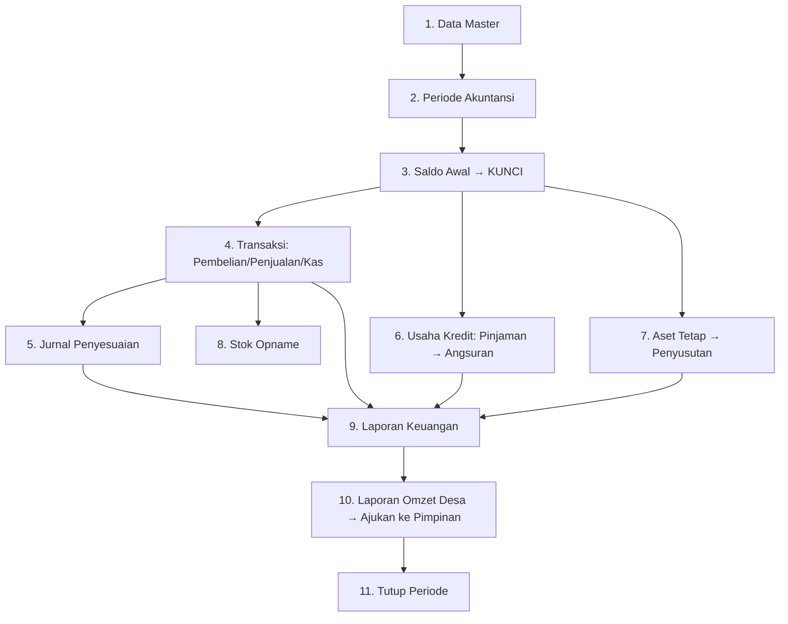

# Panduan Urutan Input Data — SIA BUMDes Munggu

Panduan ini menjelaskan **dari mana mulai menginput data** dan **urutan yang benar**,
karena setiap langkah bergantung pada langkah sebelumnya (mis. transaksi butuh produk &
periode; periode butuh saldo awal yang sudah dikunci). Angka contoh di bawah persis sama
dengan `DemoSeeder` (Januari 2026) sehingga bisa Anda cocokkan di menu **Laporan**.

> Login sebagai **Admin** untuk input. **Pimpinan** hanya melihat & menyetujui (mis. Stok
> Opname, Laporan Omzet Desa). Registrasi publik dinonaktifkan — akun dibuat lewat seeder
> atau `php artisan app:create-user`.

---

## Alur singkat



**Urutan wajib:** 1 → 2 → 3 (kunci) → baru boleh transaksi (4–8). Laporan (9) selalu
mengikuti data yang sudah diposting.

---

## Langkah demi langkah

### 1. Data Master (menu: Data Master)
Input berurutan, karena saling terkait:

1. **Unit Usaha** — mis. `Unit Usaha Dagang`, `Unit Usaha Simpan Pinjam`.
2. **Akun Akuntansi (CoA)** — sudah terisi otomatis dari `MasterDataSeeder` (Kas, Bank,
   Persediaan, Modal/Dana, Pendapatan, Beban, dll.). Tambah akun hanya bila perlu.
3. **Data Pihak** — pelanggan, pemasok, peminjam. Contoh: `Warung Bu Rai` (pelanggan),
   `CV Sumber Tani` (pemasok), `I Ketut Alit Suardika` (peminjam).
4. **Data Produk** — barang dagang + **stok minimum** (untuk peringatan "Stok Menipis").

| Kode | Produk | Harga Beli | Harga Jual | Stok Min |
|------|--------|-----------:|-----------:|---------:|
| BRG-001 | Beras 5kg | 60.000 | 75.000 | 10 |
| BRG-002 | Minyak Goreng 1L | 15.000 | 20.000 | 15 |

> Stok awal produk = 0. Stok bertambah lewat **Pembelian**, bukan diketik manual.

### 2. Periode Akuntansi (menu: Akuntansi → Periode Akuntansi)
Buat periode, mis. **Januari 2026** (01–31 Jan 2026), status *Terbuka*. Semua transaksi
harus jatuh pada tanggal di dalam periode yang ada.

### 3. Saldo Awal / Cutover (menu: Data Master → Saldo Awal) — **PALING PENTING**
Isi saldo pembuka per akun (modal awal, kas, bank, dll.), **harus seimbang
(Debit = Kredit)**, lalu **Kunci**. Setelah dikunci, transaksi baru bisa diposting dan
saldo awal tidak bisa diubah lagi.

| Akun | Debit | Kredit |
|------|------:|-------:|
| Kas | 5.000.000 | |
| Bank BUMDes | 25.000.000 | |
| Modal Dana Desa | | 25.000.000 |
| Dana Cadangan | | 3.000.000 |
| Dana Pendidikan | | 2.000.000 |
| **Total** | **30.000.000** | **30.000.000** |

### 4. Transaksi Harian (menu: Transaksi)
Alur: **buat draft → posting**. Draft belum berpengaruh; angka resmi muncul setelah
posting. Posting bersifat *immutable* — koreksi dilakukan dengan *reverse*.

1. **Pembelian** (menambah stok). Contoh 03/01 tunai:
   Beras 100 × 60.000 = 6.000.000 + Minyak 50 × 15.000 = 750.000 = **6.750.000**.
2. **Penjualan** (tunai / kredit). Contoh:
   - 10/01 tunai: Beras 70 × 75.000 + Minyak 40 × 20.000 = **6.050.000**.
   - 20/01 kredit (Warung Bu Rai): Beras 10 × 75.000 = **750.000** → jadi **Piutang Usaha**.
3. **Pemasukan & Pengeluaran (Kas)** — pendapatan/beban tunai, serta **pelunasan**
   piutang/utang.

### 5. Jurnal Penyesuaian (menu: Akuntansi → Jurnal Penyesuaian)
Untuk pos yang tidak lewat kas sederhana — mis. beban rinci, pendapatan bunga bank,
pajak. Setiap jurnal **harus seimbang**. Contoh 27/01:

- Beban Gaji 500.000, Transportasi 100.000, Biaya Kantor 50.000, Pajak Usaha 50.000
  (debit) — Bank 700.000 (kredit).
- Bank 25.000 (debit) — Pendapatan Bunga Bank 25.000 (kredit).

### 6. Usaha Kredit (menu: Usaha Kredit)
1. **Data Peminjam** — pastikan pihak peminjam ada (langkah 1).
2. **Data Pinjaman** — buat pinjaman lalu **cairkan** (kas keluar). Contoh 05/01: pokok
   1.200.000, bunga 12% flat, tenor 12 → angsuran pokok 100.000 + bunga 12.000 / bulan.
3. **Jadwal Angsuran** — tabel jatuh tempo otomatis dibuat.
4. **Pembayaran Angsuran** — contoh 25/01 bayar angsuran ke-1 (pokok 100.000 + bunga
   12.000). Sisa pokok → 1.100.000. Bunga menjadi **Pendapatan Bunga Kredit**.

### 7. Aset Tetap & Penyusutan (menu: Aset)
1. **Data Aset Tetap** — daftarkan aset. Contoh 05/01: Etalase 1.200.000, umur 12 bulan.
   (Perolehan via kas → kas keluar 1.200.000.)
2. **Penyusutan Aset** — hitung & posting penyusutan per periode. Contoh Januari:
   1.200.000 / 12 = **100.000** (Beban Penyusutan Inventaris).

### 8. Stok Opname (menu: Persediaan → Stok Opname) — opsional per periode
Admin membuat opname (stok fisik vs sistem); **Pimpinan menyetujui**; selisih diposting.

### 9. Laporan Keuangan (menu: Laporan Keuangan)
Pilih **Bulan/Tahun/Unit → Tampilkan**. Tersedia: Laba Rugi, Neraca, Perubahan Modal,
Arus Kas, Laporan Kredit, Laporan Omzet Desa. Bisa **Cetak / Unduh PDF / Unduh Excel**.

### 10. Laporan Omzet Desa (menu: Laporan → Laporan Omzet Desa)
Admin **generate snapshot** omzet → **Ajukan ke Pimpinan** → Pimpinan **menyetujui**.
Snapshot yang disetujui bersifat final; revisi membuat versi baru.

### 11. Tutup Periode (menu: Akuntansi → Periode Akuntansi)
Setelah semua transaksi & laporan beres, **tutup periode**. Saldo akhir menjadi saldo
awal periode berikutnya (carry-forward).

---

## Hasil yang seharusnya muncul (contoh Januari 2026)

**Laporan Laba Rugi**

| Keterangan | Nilai (Rp) |
|------------|-----------:|
| Penjualan (Usaha Dagang) | 6.800.000 |
| Harga Pokok Penjualan | 5.400.000 |
| **Laba Kotor** | **1.400.000** |
| Pendapatan Bunga Kredit | 12.000 |
| Pendapatan Bunga Bank | 25.000 |
| **Laba Setelah Pendapatan Lain** | **1.437.000** |
| Beban Gaji Pegawai | 500.000 |
| Beban Transportasi | 100.000 |
| Beban Biaya Kantor | 50.000 |
| Beban Penyusutan Inventaris | 100.000 |
| **Total Beban** | **750.000** |
| **Laba Sebelum Pajak** | **687.000** |
| Pajak Usaha | 50.000 |
| **Laba Bersih Januari** | **637.000** |

**Neraca per 31 Januari 2026** (seimbang)

| Aktiva | Rp | Pasiva | Rp |
|--------|---:|--------|---:|
| Kas & Bank | 26.337.000 | Kewajiban | 0 |
| Piutang Usaha | 750.000 | Modal Dana Desa | 25.000.000 |
| Piutang Pinjaman | 1.100.000 | Dana Cadangan | 3.000.000 |
| Persediaan | 1.350.000 | Dana Pendidikan | 2.000.000 |
| Aset Tetap (neto) | 1.100.000 | Laba Januari | 637.000 |
| **Total Aktiva** | **30.637.000** | **Total Pasiva** | **30.637.000** |

---

## Aturan penting
- **Saldo awal harus seimbang dan dikunci** sebelum transaksi apa pun.
- **Draft tidak berpengaruh**; hanya transaksi **terposting** yang masuk laporan.
- **Posting immutable** — perbaiki dengan *reverse*, bukan edit/hapus.
- **Pokok pinjaman, pelunasan, dan modal bukan omzet.**
- **Stok tidak boleh negatif** dan tidak bisa mundur tanggal (no backdate).
- Angka uang memakai **2 desimal** (`Rp 637.000,00`).

---

## Memuat data contoh (opsional, untuk belajar)
`DemoSeeder` mengisi seluruh contoh di atas sekaligus. **Menghapus data lama**, jadi
hanya untuk database pengembangan/UAT:

```bash
php artisan migrate:fresh
php artisan db:seed --class=DemoSeeder
```

Hanya ingin akun login (tanpa data transaksi), lihat
[`UserSeeder`](../database/seeders/UserSeeder.php):

```bash
php artisan db:seed --class=UserSeeder
```
